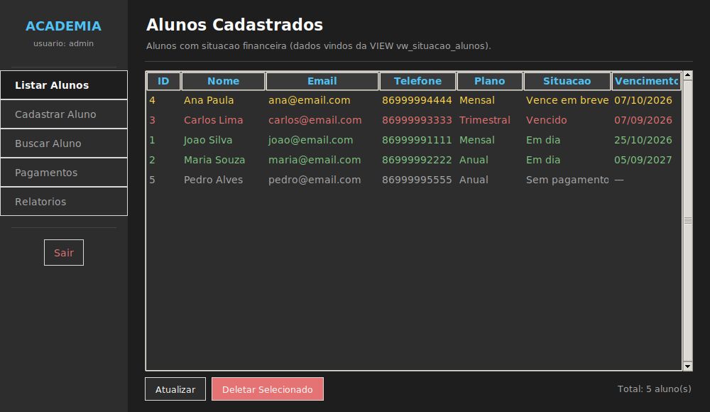
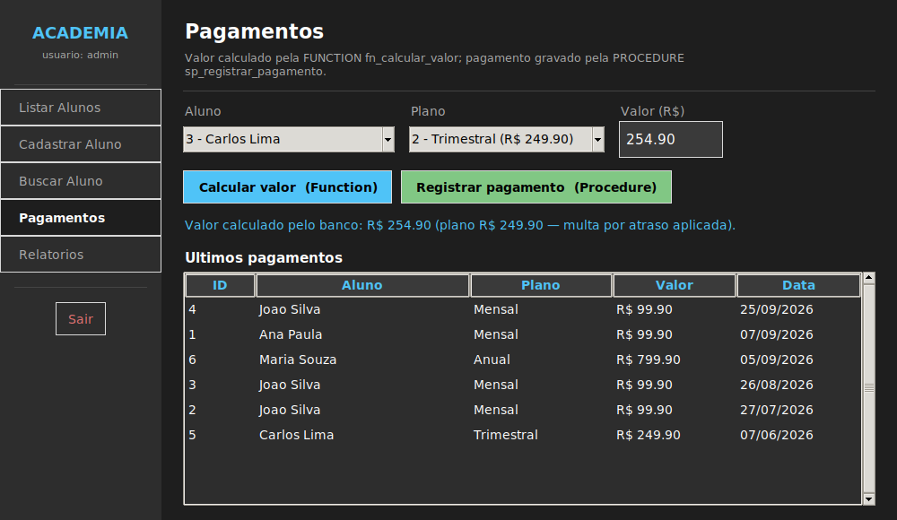
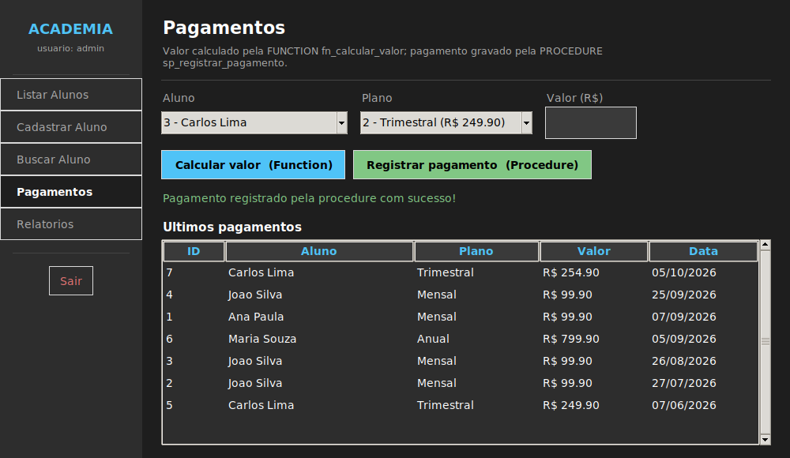
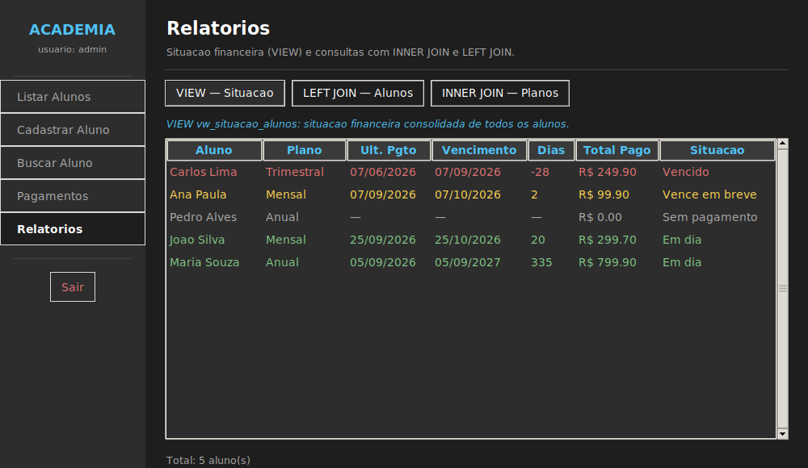

# Sistema de Gerenciamento de Academia

## Identificação
- **Aluno (trabalho individual):** João Victor da Cunha Oliveira
- **Disciplina:** Projeto Banco de Dados
- **Professor:** Anderson

## Sobre o projeto
Sistema para gerenciar os alunos de uma academia: cadastro, planos, pagamentos e acompanhamento da situação financeira de cada aluno.

O problema que resolve: o dono da academia precisa saber, rapidamente, **quem está em dia, quem está vencendo e quem está inadimplente**, calcular o valor correto da mensalidade (desconto de fidelidade e multa por atraso) e registrar o pagamento de forma segura. Essa lógica foi levada para dentro do banco de dados, com **View, Function e Procedure**, e não fica espalhada no código Python.

## Tecnologias utilizadas
- Python 3 (biblioteca `psycopg2-binary`)
- Tkinter (interface gráfica) e terminal (versão console)
- PostgreSQL
- pgAdmin 4

## Banco de dados
**SGBD:** PostgreSQL

**Principais tabelas**

| Tabela | Descrição |
|---|---|
| `planos` | Planos da academia (Mensal, Trimestral, Anual), com preço e duração em meses |
| `alunos` | Dados do aluno e plano atual |
| `pagamentos` | Histórico de pagamentos (aluno, plano, data e valor) |

Diagrama: [`docs/diagrama_academia.png`](docs/diagrama_academia.png)

### View: `vw_situacao_alunos`
- **Por que existe:** reúne em uma única consulta alunos, planos e pagamentos (3 tabelas), calcula a data de vencimento e classifica cada aluno em *Em dia*, *Vence em breve* (até 7 dias), *Vencido* ou *Sem pagamento*.
- **Retorna:** uma linha por aluno, com último pagamento, vencimento, dias para vencer, total pago, quantidade de pagamentos e situação.
- **Onde é usada:** tela **Listar Alunos** e tela **Relatórios > VIEW — Situação** (`interface_academia.py`); no console, menu *Alunos > Listar* e *Relatórios > 1*.
- **Script:** [`database/views/vw_situacao_alunos.sql`](database/views/vw_situacao_alunos.sql)

### Function: `fn_calcular_valor(p_aluno_id, p_plano_id)`
- **O que faz:** calcula o valor a cobrar do aluno: preço do plano, com **5% de desconto de fidelidade** para quem já fez 3 ou mais pagamentos e **2% de multa** se o último plano já está vencido.
- **Parâmetros:** id do aluno e id do plano. **Retorna:** `NUMERIC(10,2)`. Gera erro se aluno ou plano não existirem.
- **Onde é usada:** tela **Pagamentos**, botão *Calcular valor (Function)*; no console, ao registrar pagamento.
- **Script:** [`database/functions/fn_calcular_valor.sql`](database/functions/fn_calcular_valor.sql)

### Procedure: `sp_registrar_pagamento(p_aluno_id, p_plano_id, p_valor)`
- **O que faz (na mesma transação):** valida aluno, plano e valor → insere o pagamento em `pagamentos` → atualiza o plano do aluno em `alunos`. Se algo falhar, nada é gravado.
- **Parâmetros:** id do aluno, id do plano e valor pago (maior que zero).
- **Onde é chamada:** tela **Pagamentos**, botão *Registrar pagamento (Procedure)*, com `CALL sp_registrar_pagamento(...)`; no console, menu *Pagamentos > Registrar*.
- **Script:** [`database/procedures/sp_registrar_pagamento.sql`](database/procedures/sp_registrar_pagamento.sql)

### Fluxo integrado
`Tela Pagamentos → fn_calcular_valor (Function) → valor exibido → sp_registrar_pagamento (Procedure) → pagamento gravado → View mostra a nova situação do aluno`

## Estrutura do repositório
```
/src
│   sistema_academia.py        # versão console
│   interface_academia.py      # interface gráfica (Tkinter)
/database
│   executar_tudo.sql          # roda todos os scripts na ordem correta (via psql)
│   /tables      01_criar_tabelas.sql
│   /views       vw_situacao_alunos.sql
│   /functions   fn_calcular_valor.sql
│   /procedures  sp_registrar_pagamento.sql
│   /inserts     01_dados_iniciais.sql
/docs            diagrama, prints, consultas de exemplo e roteiro do vídeo
README.md
```

## Como executar
1. Instale o PostgreSQL e a dependência Python:
   ```bash
   pip install psycopg2-binary
   ```
2. Crie o banco `Academia_db` (pgAdmin 4 ou terminal):
   ```bash
   psql -U postgres -c "CREATE DATABASE \"Academia_db\";"
   ```
3. Execute os scripts da pasta `database` na ordem: **tabelas → dados → view → function → procedure**.
   - **No pgAdmin 4:** botão direito em `Academia_db` > *Query Tool*, abra cada arquivo (ícone de pasta) e execute com **F5**, um por vez, nessa ordem.
   - **Pelo terminal (psql):** um único comando roda tudo:
     ```bash
     cd database
     psql -U postgres -d Academia_db -f executar_tudo.sql
     ```
4. Configure a senha do PostgreSQL. O padrão do código é `academia123`. Para usar outra, defina a variável de ambiente antes de rodar:
   ```bash
   # Windows (PowerShell)
   $env:ACADEMIA_DB_PASSWORD = "sua_senha"
   # Linux / macOS
   export ACADEMIA_DB_PASSWORD="sua_senha"
   ```
5. Rode a aplicação:
   ```bash
   python src/interface_academia.py     # interface gráfica
   python src/sistema_academia.py       # versão console
   ```

> Os pagamentos de teste usam datas relativas ao dia atual, então a View sempre mostra as quatro situações (Em dia, Vence em breve, Vencido e Sem pagamento).

## Login
- Usuário: `admin` | Senha: `1234`
- Usuário: `professor` | Senha: `senha`

## Prints da aplicação

**Listar alunos (View)**



**Pagamentos: Function calculando o valor**



**Pagamentos: Procedure registrando o pagamento**



**Relatório de situação (View)**



Outros prints: [login](docs/prints/01_login.png), [LEFT JOIN](docs/prints/06_left_join.png), [INNER JOIN](docs/prints/07_inner_join.png).

## Vídeo explicativo
🎥 **Link do vídeo:** COLE_AQUI_O_LINK_DO_VIDEO